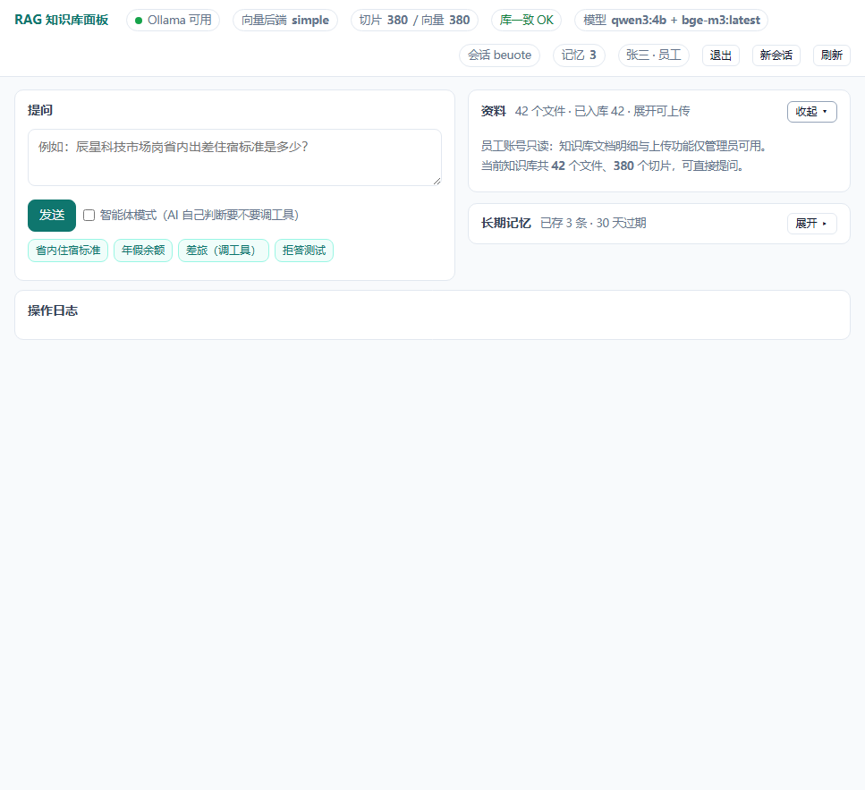
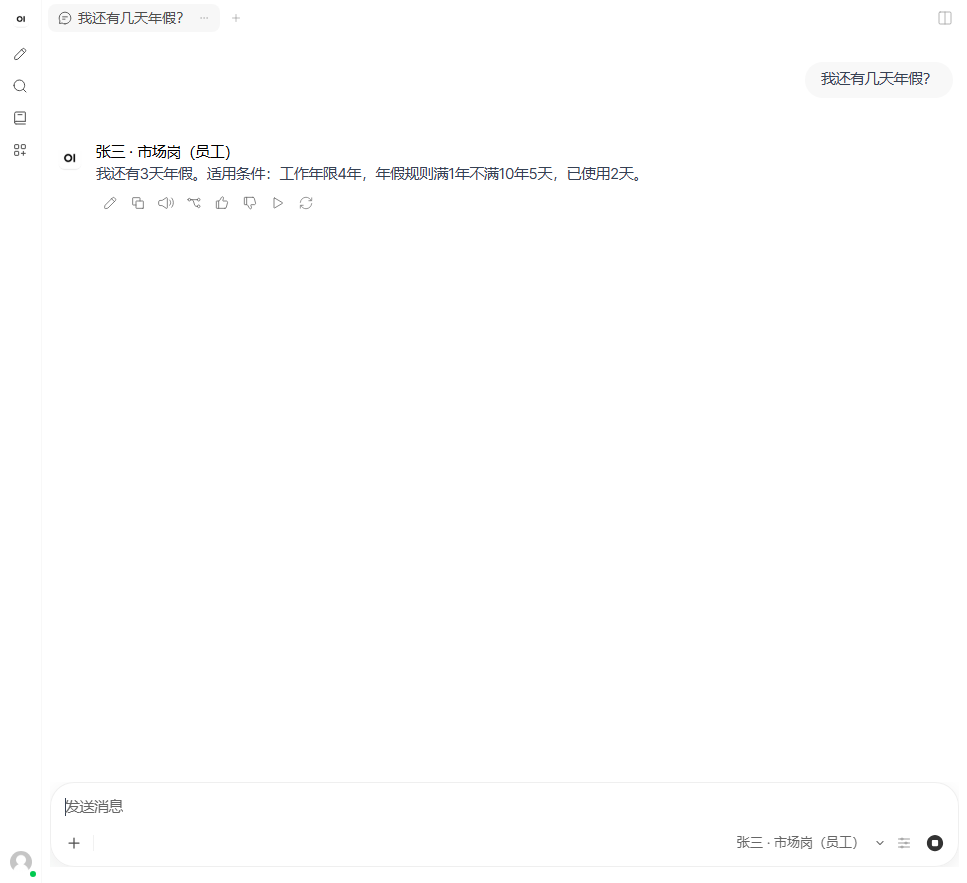

# 企业私有化知识库 · RAG + Agent

把一堆企业制度文档变成「只依据原文回答、能给出处、记录谁问了什么」的问答系统。**全部跑在一台普通办公电脑上**：本地模型、本地向量库、零 Docker、零外网依赖。

<p align="center">
  
  
</p>

<p align="center"><i>左：内置面板（员工视角，只读资料卡）；右：接 Open WebUI 后的聊天界面</i></p>

---

## 为什么做这个

企业里真实的一幕：制度文件散在十几个文件夹，员工查不到，HR 每天回答同样的问题。扔给云端大模型有两个过不去的坎——**数据合规**，以及**它编答案**。

这个项目的取舍很明确：宁可回答「知识库中未找到相关条款」，也不让模型自由发挥；每条回答都能追到文件名、页码、相似度；每一次提问都落审计日志。

## 和常见 RAG Demo 的差别

| | 常见 Demo | 本项目 |
|---|---|---|
| 检索 | 单路向量相似度 | 向量 + BM25（jieba 分词），RRF 融合，命中后带同文件相邻块 |
| 检索不到 | 照样让模型答 | 双阈值拒答（cos < 0.45 且 bm25 < 1.0） |
| 权限 | 无 | JWT + `employee` / `admin`，接口级鉴权，会话与记忆按账号隔离 |
| 安全 | 无 | 三级敏感词表 + 前置拦截 + 后置可疑复核（只在可疑时调模型） |
| 审计 | 无 | 每轮落 JSONL：问题、召回、工具调用、耗时、trace_id |
| 记忆 | 无 | 短期会话（12 条）+ 长期事实（独立向量库，30 天过期） |
| 工具 | 无 | 参数化工具（年假查询、差旅标准），带强制角色校验 |
| 编排 | LangChain 一把梭 | 自研 ReAct，固定 8 步上限，每一步可观测 |
| 部署 | Docker Compose + 云模型 | 单个 Python 进程 + 本地 Ollama |

## 架构

```
前端  内置面板 (FastAPI 单页)          Open WebUI（可选，走 OpenAI 兼容层）
          │  JWT                          │  Bearer API Key
          ▼                               ▼
┌──────────────────────────────────────────────────┐
│  app/web/server.py   FastAPI                      │
│   ├─ AuthMiddleware：JWT 解析 / 角色注入 / 401     │
│   ├─ /api/ask /api/upload /api/audit …            │
│   └─ /v1/chat/completions   OpenAI 兼容层          │
└───────────────────────┬──────────────────────────┘
                        ▼
┌──────────────────────────────────────────────────┐
│  Agent  app/agent/  自研 ReAct（最多 8 步）        │
│   ① 输入护栏  → 命中直接拒答                       │
│   ② 长期记忆召回（按 user_id）                    │
│   ③ 路由：直接回答 / 查文档 / 调工具               │
│   ④ 输出护栏  → 可疑才调模型复核                   │
└──────┬──────────────────────────┬────────────────┘
       ▼                          ▼
┌──────────────────┐      ┌──────────────────────┐
│ 检索              │      │ 工具                  │
│ 向量 + BM25 → RRF │      │ query_annual_leave   │
│ 邻接扩展 + 重排    │      │ query_travel_standard│
└────────┬─────────┘      └──────────────────────┘
         ▼
┌──────────────────────────────────────────────────┐
│  Ollama   bge-m3（1024 维向量） / qwen3:4b（生成） │
└──────────────────────────────────────────────────┘
```

## 快速开始

前提：Python ≥ 3.10、[Ollama](https://ollama.com) 已在本机运行。

```bash
# 1) 拉两个本地模型（约 3 GB，只做一次）
ollama pull qwen3:4b
ollama pull bge-m3

# 2) 装依赖
python -m venv .venv
.venv\Scripts\activate            # Windows；macOS/Linux 用 source .venv/bin/activate
pip install -r requirements.txt

# 3) 一键建库：加载 → 切片 → 向量化 → 入库 → 检索自检 → 出报告
python -m app.rag.build

# 4) 命令行提问（加 --debug 会打印召回片段和分数）
python -m app.rag.qa "市场岗省内出差住宿标准是多少？" --debug

# 5) 起图形面板
python -m app.web.server          # 或双击 启动面板.bat
# 打开 http://127.0.0.1:8765，用 U001 / 123456 登录
```

示例账号（`mock_data/users.json`，密码是 pbkdf2 哈希，改密码用 `scripts/make_user.py`）：

| 账号 | 密码 | 角色 |
|---|---|---|
| U001（张三 · 市场岗） | 123456 | employee |
| U002（李四 · 技术岗） | 123456 | employee |
| admin | admin123 | admin |

> 示例文档在 `demo_docs/`，全部是**虚构内容**。换成自己的资料：把 `RAG_DOCS_DIR` 指向目标目录，再 `python -m app.rag.build --rebuild`。

## 三个刻意做对的地方

### 1. 拒答阈值是实测出来的，不是拍脑袋

企业场景里"答错"比"答不出"贵得多。所以检索完先算两个分：向量余弦 `cos`、BM25 原始分，规则是：

- `cos ≥ 0.60` → 直接用；
- `0.45 ≤ cos < 0.60` 且 `bm25 ≥ 1.0` → 也算相关（覆盖"关键词精确命中但语义分数被稀释"的情况）；
- 两条都不满足 → 拒答，不让模型看到原文。

阈值来自在这个语料上跑回归集调出来的：0.60 以上基本没有误召，0.45 以下误召明显上升。`python -m app.rag.eval` 会把 10 条回归用例（含 2 条必须拒答的）跑一遍。

### 2. 长期记忆不是"条数越多越检索越好"

最初的设计是每条记忆都走向量召回，实测发现短事实句（"岗位：市场岗"）的余弦区分度极低——问题"我的住宿标准该按哪一档"对它的分数只有 0.43，直接漏掉。

改成：**记忆不超过 6 条时全量注入 prompt**，超过 6 条才走向量检索（阈值提到 0.50，比制度检索更严）。同时对注入的记忆标注"非制度条款"，避免模型把它当制度依据引用。参数都在 `app/rag/config.py` 里，注释写了取值理由。

### 3. 护栏不能每条都调模型

两级校验：前置用三级词表（硬拦截 / 软提示 / 白名单）扫一遍，绝大多数请求 0 成本；只有**问题本身命中软词**时才额外调一次模型复核输出。这样既不会每条都多花几分钟，也不会因为换个说法就漏。

## 实测数据

### 本仓库自带的示例库（9 份文档 → 14 个切片）

| 项目 | 结果 |
|---|---|
| 建库（加载→切片→向量化→入库→自检） | 约 10 秒 |
| 检索自检 | 3/3 PASS（含 1 条必须拒答的幻觉测试） |
| 单条问答「市场岗省内住宿标准」 | 170 秒 → 350 元/晚，带 `[1]` 出处 |

### 完整语料（42 个文档 / 380 个切片，i5-12400 / 16 GB / 无独显）

| 场景 | 结果 |
|---|---|
| 建库（含向量化） | 约 3 分钟 |
| 纯检索问答（不调工具） | 2~3 分钟 |
| 走工具 + 多轮（年假查询） | 4~5 分钟 |
| 拒答（未找到条款） | 约 1 分钟 |
| 回归集通过率 | 10/10（含 2 条拒答） |

单测（标准库 `unittest`，不依赖 Ollama）：`python -m unittest discover -s tests` —— 51 例，0.3 秒全通过（鉴权 12 / 护栏 16 / 记忆 13 / Agent 10）。

## 已知限制（很重要，别拿去直接上线）

1. **慢**。CPU 跑 4B 模型，一轮 2~9 分钟。企业内部工具的容忍线是首字 5 秒，这个差距只能靠换模型或上显卡解决。
2. **吃内存**。两个 llama-server 占约 6 GB，16 GB 机器跑完只剩 0.4~1.7 GB 可用。
3. **文档接入是演示级**。只支持 `.txt/.md/.pdf/.docx`，扫描件、Excel、PPT 不支持；增量更新靠手动重入库。
4. **没有引用高亮**。能给出文件名/页码/原文，但前端没有跳到原文位置的功能。
5. **单机单进程**。没有并发控制、没有任务队列，多人同时提问会排队抢 Ollama。
6. **Open WebUI 那层没有账号隔离**。为了省事设了免登录，三个身份靠下拉切换；真正的多用户隔离还没做。

## 目录

```
app/
  agent/       ReAct 编排、LLM 客户端、工具、状态
  rag/         加载、切片、向量化、混合检索、评测、向量库双后端
  memory/      短期会话、长期事实、规则抽取
  web/         FastAPI 面板 + OpenAI 兼容层
  auth.py      JWT 签发校验、角色
  guardrail.py 三级词表与前后置校验
  logger.py    审计日志
scripts/       环境自检、冒烟测试、建账号、启动辅助
tests/         4 个 pytest 文件 + 回归问答集
demo_docs/     虚构的示例制度文档
docs/          技术设计与踩坑记录
```

## 更多文档

- [技术设计](docs/技术设计.md)：参数取值依据、记忆策略、护栏分级、向量后端为什么默认不是 Chroma
- [踩坑记录](docs/踩坑记录.md)：chromadb 段错误、qwen3 思考截断、torch 缺 DLL、Open WebUI 偷偷打 RAG 等

## License

MIT
